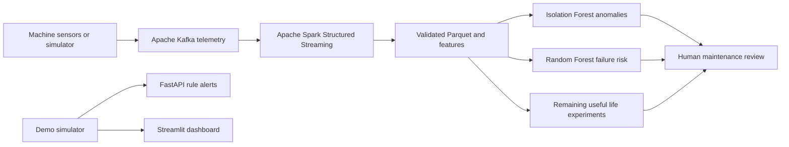

# IoT Predictive Maintenance — Kafka + Spark + Machine Learning

**Industrial IoT predictive-maintenance research prototype** featuring typed telemetry, synthetic sensor simulation, Apache Kafka data transport, Spark Structured Streaming ingestion, basic anomaly detection, equipment failure prediction, remaining-useful-life experiments, a FastAPI rule-scoring service, and a Streamlit demonstration dashboard.

> **Research prototype:** All demo telemetry is synthetic. No real-world industrial accuracy, deployment readiness, or live-sensor integration is claimed.

## Architecture



The streaming path writes validated events to Parquet. The rule-scoring API and dashboard operate as independent demonstrations; automated real-time inference, Kafka alert publication and unified monitoring are planned extensions, **not yet integrated**.

## Quick start

Requires Python 3.10+.

```bash
git clone https://github.com/halim-abdul/IoT-Predictive-Maintenance-Kafka-Spark.git
cd IoT-Predictive-Maintenance-Kafka-Spark
python -m venv .venv
source .venv/bin/activate
pip install -e '.[api,dashboard,dev]'
pytest -q
python -m iot_pm.simulation.generator --records 1000 --output data/sample/sensors.csv
python -m iot_pm.ml.cli --input data/sample/sensors.csv
uvicorn iot_pm.api.app:app --reload
```

On Windows PowerShell use `.venv\Scripts\Activate.ps1`. Browse `http://localhost:8000/docs` for HTTP API examples. To launch charts in another terminal use `streamlit run src/iot_pm/dashboard/app.py`.

## Kafka setup

```bash
pip install -e '.[stream,api]'
docker compose up -d kafka
bash scripts/create_topics.sh
python -m iot_pm.streaming.producer --count 100 --interval 0.1
```

For Spark configure an external Spark distribution and its compatible Kafka connector, then run `bash scripts/run_spark.sh`. The example Compose Python container is **not** a fully configured Spark runtime; a matching Spark environment is required. The Kafka broker and producer are the local transport demonstration.

## Modeling

- Random Forest classifier with group holdout by machine, imputation and class weighting.
- Isolation Forest anomaly scoring without assumed labeled anomaly events.
- Remaining useful life targets derived from observed synthetic failure events; right-censored records require better methods in real deployments.
- Rule-based severity alerts with human-readable explanations.
- PSI-based feature drift monitoring.
- FastAPI `GET /health`, `GET /models`, `POST /alerts/score`.

## Ten notebooks

| Notebook | Research topic |
|---|---|
| 01 | Telemetry distributions |
| 02 | Data validation |
| 03 | Sensor feature engineering |
| 04 | Anomaly detection |
| 05 | Failure classification |
| 06 | Threshold tuning |
| 07 | Remaining useful life |
| 08 | Machine visualizations |
| 09 | Population drift |
| 10 | Alert review |

## Documentation

- [Architecture and event contracts](docs/architecture/README.md)
- [Machine-learning methodology](docs/ml/README.md)
- [Operations runbook](docs/operations/README.md)
- [Data assumptions](docs/data/README.md)
- [API reference](docs/api/README.md)
- [Experiment protocol](docs/experiments/README.md)
- [Notebook guide](docs/notebooks/README.md)
- [Contributing](CONTRIBUTING.md) · [Security](SECURITY.md) · [Changelog](CHANGELOG.md)

## Research caveats

Synthetic labels are correlated with artificial wear dynamics. Machine-level holdout alone is insufficient to prove generalization; use time-forward/site-forward evaluation, failure lead time, recall under alert budgets, false positives per asset-day, censoring-aware RUL evaluation and probability calibration on externally sourced datasets. Never connect this demonstration directly to safety-critical equipment.

MIT-licensed; see [LICENSE](LICENSE).
